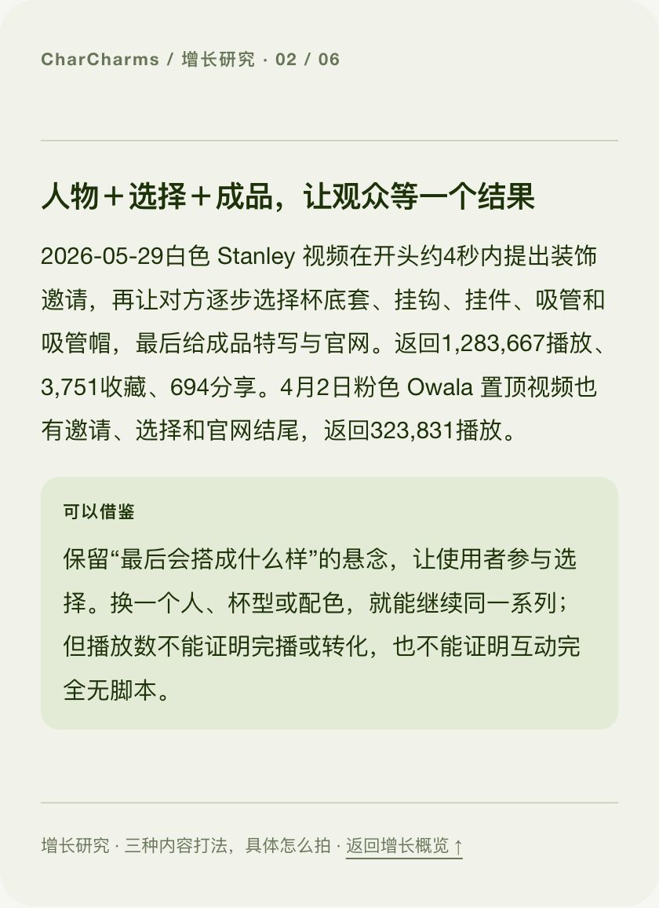
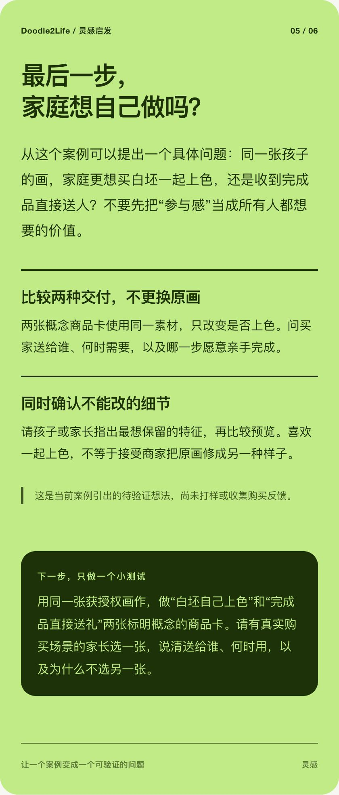
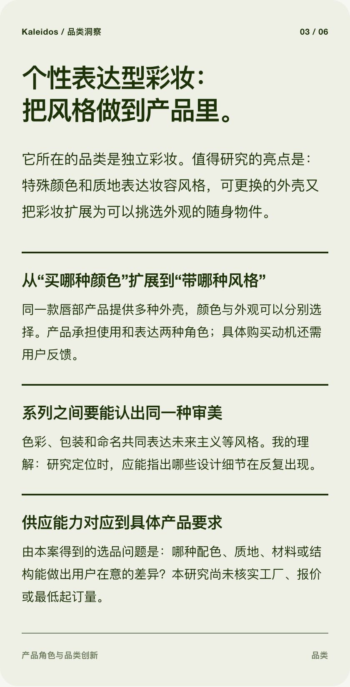

# Hi, I'm Paris Young

**AI Agents × Marketing × Independent Brands**

**English** · [中文](README.zh-CN.md)

I build reusable agent workflows for brand research, audience decisions and content production. My background is in marketing, advertising, social media and e-commerce; Claude, Codex and Obsidian are part of my working setup.

I'm also building a Shopify business in public: learning from brands, exploring product niches, testing user needs, and asking how Chinese supply-chain capabilities can become products and brands that overseas customers choose.

This portfolio brings together those two threads: **tools you can use in your own work, and a public record of what I learn while building.**

## Five tools, five starting questions

| Your question | Tool | What you get |
| --- | --- | --- |
| What can I learn from this brand and apply to my project? | [Brand Research Brain](https://github.com/parisyxc/brand-research-brain) | Linked brand studies, category insights, growth learning, product hypotheses and readable HTML. |
| How should I look at an audience before researching it? | [Audience Lens Selector](https://github.com/parisyxc/audience-lens-selector) | A segmentation lens, contrasting hypotheses and a handoff for listening, interviews or surveys. |
| What cultural meaning does this brand carry? | [Cultural Brand Analyzer](https://github.com/parisyxc/cultural-brand-analyzer) | A reading of archetypes, tensions, ideology, myths, symbols and rituals, grounded in Douglas Holt's work. |
| How do I turn a real product capability into a video idea? | [Product Video Studio](https://github.com/parisyxc/product-video-studio) | Usage scenarios, tension cards and scripts; a storyboard prompt pack after script approval. |
| What questions should my brand answer for people and AI search? | [GEO Content Planner](https://github.com/parisyxc/geo-content-planner) | A query map, structured answer units and a monthly platform distribution plan. |

### Explore the other four tools

- **Audience Lens Selector** starts with the marketing decision. It separates a useful research lens from demographics or platform labels, and turns assumptions into questions that research can test. [Skill](https://github.com/parisyxc/audience-lens-selector/blob/main/SKILL.md) · [Demo files](https://github.com/parisyxc/audience-lens-selector/tree/main/demo)
- **Cultural Brand Analyzer** helps explain the cultural contradiction a brand addresses and the meaning its symbols and rituals carry. Its focus is interpretive cultural analysis. [Skill](https://github.com/parisyxc/cultural-brand-analyzer/blob/main/SKILL.md) · [Usage](https://github.com/parisyxc/cultural-brand-analyzer/blob/main/USAGE.md) · [Demo files](https://github.com/parisyxc/cultural-brand-analyzer/tree/main/demo)
- **Product Video Studio** takes a product, one capability to feature, and a format. It develops scenarios, tension and script, then pauses for approval before storyboarding. The output supports production; rendering video is a separate step. [Skill](https://github.com/parisyxc/product-video-studio/blob/main/SKILL.md) · [Demo files](https://github.com/parisyxc/product-video-studio/tree/main/demo)
- **GEO Content Planner** takes a brand, a consumer situation and platform roles. It connects customer queries to answer modules and distribution, so content can accumulate into useful evidence for AI search. Being cited or recommended remains something to measure. [Skill](https://github.com/parisyxc/geo-content-planner/blob/main/SKILL.md) · [Demo files](https://github.com/parisyxc/geo-content-planner/tree/main/demo)

These are independent tools. Choose the one that fits your current decision, and pass a clear brief and relevant evidence between them. Each repository explains how to use its skill, references and templates. Download HTML demos to view them in a browser.

## My current build: a Shopify research and learning Brain

### [Brand Research Brain →](https://github.com/parisyxc/brand-research-brain)

When choosing a product niche, I kept collecting interesting brands across bookmarks, notes and conversations. I wanted those observations to become something I could return to, compare and brainstorm with.

Brand Research Brain turns that into a repeatable workflow:

**Share a website → understand the business → learn three concrete practices → save linked knowledge and HTML → develop your own testable ideas.**

Websites, articles and clips can all be starting inputs. Learning accumulates across four dimensions:

- **Brand:** who buys what, why they might consider it, and how positioning appears in the product and storefront.
- **Category:** the brand's actual category, its distinctive product move, and the tradeoffs worth studying.
- **Growth:** on-demand investigation of social media, creators and SEO, with concrete examples and evidenced stages.
- **Ideas:** hypotheses from the current case, connected to past learning and a small next test.

Useful Shopify storefront and conversion practices are saved alongside those notes. The workflow draws on Karpathy's LLM Wiki pattern: preserve sources in `raw/`, maintain linked knowledge in `wiki/`, and keep the Brain readable in Markdown and Obsidian. Each study also produces a Chinese HTML learning report for reading and sharing.

### Three examples from my research

| Case | What I studied | The question it opened up |
| --- | --- | --- |
| **CharCharms** | Water-bottle accessories that combine small utilities and self-expression; content built around a person's choices and the finished result. | Could a concert accessory let the user participate in the design while making the transformation worth watching? |
| **Doodle2Life** | Children's drawings turned into paintable keepsakes, with professional production followed by a family activity. | Does the buyer want something to finish together, or a finished gift ready to give? |
| **Kaleidos** | Distinctive color cosmetics, aesthetic consistency and interchangeable product components. | How can aesthetic preferences become concrete color, material and structure requirements for a supplier? |

These are studies of public brands: observations, interpretations and questions for further validation. My own product direction is still developing.

<details>
<summary><strong>See three actual research cards</strong></summary>

The cards below are in Chinese.

### CharCharms: learning from a specific content example



### Doodle2Life: turning a case into a small test



### Kaleidos: understanding the category and product first



</details>

### Install Brand Research Brain

The first release targets **Codex and Claude Code** with file access, Python 3.9+ and host-provided browsing tools. Basic research requires no additional paid data API; your existing agent and search usage still applies.

**Codex — run in your terminal:**

```sh
codex plugin marketplace add https://github.com/parisyxc/brand-research-brain.git
codex plugin add brand-research-brain@brand-research-brain
```

**Claude Code — run in your terminal:**

```sh
claude plugin marketplace add parisyxc/brand-research-brain
claude plugin install brand-research-brain@brand-research-brain
```

Refresh or start a new session as your client directs. Then try:

> Use Brand Research Brain to create a Shopify learning Brain in my chosen folder. I'm exploring product niches and want to learn product selection, positioning and content. Study this website: [URL]. Explain its business and category angle, teach me three concrete practices, develop ideas from this case, and save linked Markdown plus a Chinese HTML report.

Later, keep using the same Brain:

> Based on the cases I've studied, brainstorm this idea with me: [idea]. Compare specific practices, conditions and tradeoffs, and suggest one small test.

[Repository](https://github.com/parisyxc/brand-research-brain) · [Chinese guide](https://github.com/parisyxc/brand-research-brain/blob/main/README.zh-CN.md) · [Claude guide](https://github.com/parisyxc/brand-research-brain/blob/main/docs/claude-release.md) · [Releases](https://github.com/parisyxc/brand-research-brain/releases)

The other four projects provide their own skill-loading instructions and supporting materials in their repositories. Use those instructions for each tool; the commands above install Brand Research Brain.

## What I'm exploring next

- Product and category opportunities grounded in user problems, communities and brand cases.
- Agent workflows that carry evidence from research into creative and marketing decisions.
- A separate **China Warehouse** experiment: translating specific supplier and SKU information into positioning and content directions.
- The path from research and validation to sourcing, a Shopify storefront and growth experiments.

I share changing judgments, useful outputs and reusable methods as I go. Public examples use public brands or fictional briefs; they are not client case studies.

## Say hi

Exploring independent brands, marketing tools or AI Agent workflows? Try a tool, share a case, or open an issue in its repository.

[Browse my projects](https://github.com/parisyxc?tab=repositories) · [Email](mailto:parisyxc@gmail.com)
